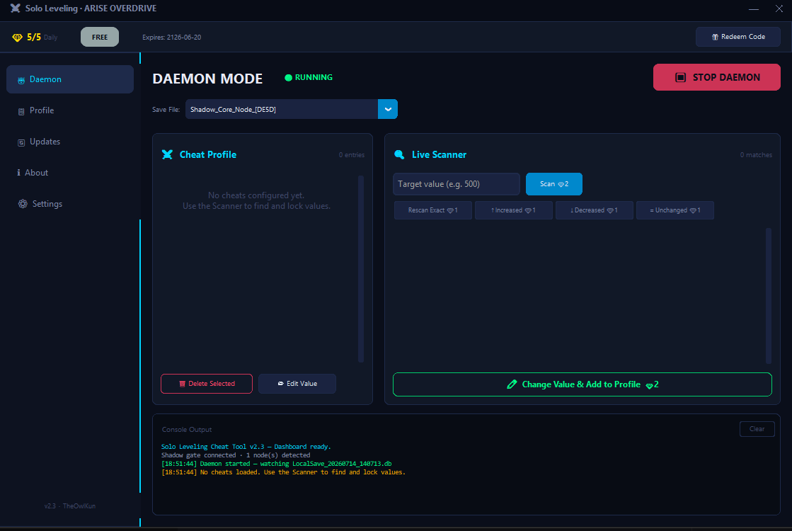
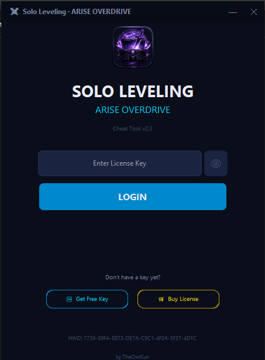

<div align="center">
  # ✨ Arise Overdrive
  
  **The ultimate undetected graphical inventory manager and offline cheat tool for Solo Leveling: ARISE.**
  
  [](https://github.com/TheOwlKun/Solo-Leveling-inventory-cheat-tool/releases)
  [](https://github.com/TheOwlKun/Solo-Leveling-inventory-cheat-tool/releases)
  [](https://discord.gg/mG5uMeGwd6)
  [](https://discord.gg/mG5uMeGwd6)
</div>

<br>

<div align="center">
  
</div>

## ✨ Overview

Welcome to the initial public release of **Arise Overdrive**! 

Arise Overdrive v2.3 is a fully graphical (GUI) memory scanner and inventory editor for *Solo Leveling: ARISE*. Designed with a zero-trust architecture, it allows players to visually intercept and overwrite local item quantities without triggering standard anti-cheat heuristics. This repository marks our first public version of the tool.

## 🛡️ Core Features

*   **Complete Graphical Interface**: No more typing commands in a terminal. Everything from scanning to locking items is done through a sleek, custom-built UI with a dark "Shadow Monarch" theme.
*   **Offline First**: Fully functional without constant server tracking. Your profile and keys are cached securely on your local machine.
*   **Zero Telemetry**: We respect your privacy. No usage data, hardware profiles, or gameplay statistics are ever logged or transmitted.
*   **Smart Memory Editor (The Daemon)**: A built-in visual scanner that lets you locate any item quantity, lock it, and force the game client to retain that amount infinitely.
*   **Fail-Closed Security**: Game DB encryption keys are dynamically fetched post-login; nothing is hardcoded in the executable.
*   **5-Layer Anti-Tamper Engine**: Protects the executable from debuggers, timing attacks, and reverse engineering tools while allowing legitimate VM users to play freely.

## 📦 Quick Start

```bash
# 1. Download the latest release from the Releases tab
# https://github.com/TheOwlKun/Solo-Leveling-inventory-cheat-tool/releases

# 2. Run the executable (add exclusion to Windows Defender if flagged)
./SoloLeveling_CheatTool.exe

# 3. Click "Get Free Key" on the UI to register a free HWID-bound key
# 4. Launch the game and begin editing
```

<div align="center">
  
</div>

## 💻 Usage

Arise Overdrive's **Daemon Page** provides a real-time, visual workflow for editing your inventory. 

**Workflow:** `Scan Quantity` ➔ `Use Item In-Game` ➔ `Rescan Quantity` ➔ `Overwrite & Lock`

1. **Initial Scan**: In the Daemon UI, enter the exact amount of the item you want to modify (e.g., `15` Gold) into the **Scan** input box and click Scan.
2. **Modify State**: Go into the game and consume, sell, or drop that item so the quantity changes.
3. **Rescan**: Return to the Daemon, enter the new quantity (e.g., `13`) in the **Rescan** box, and click Rescan. This isolates the exact memory address.
4. **Lock & Overwrite**: Enter your desired amount (e.g., `9999`) and a name for the cheat profile, then click **Lock**.

> [!TIP]
> **Infinite Loop Activation:** Once an item is locked, any time you consume that item in-game, the Daemon will instantly catch the change and refill your inventory back to the locked amount.

## 💎 Economy (The Orb System)

Arise Overdrive operates on a daily allowance system (**Orbs**) to prevent abuse and server load. Actions like scanning and locking items are processed visually through the UI but deduct from your daily allowance. Your current balance and daily cap are always visible in the top status bar.

*   **Free Tier**: 5 Orbs daily. Resets automatically at 00:00 UTC.
*   **Upgrades**: Visit the Discord to upgrade to **B-Rank, A-Rank, or S-Rank** for up to 100 Orbs daily.

## 🤝 Community & Support

Need help bypassing a specific check? Want to upgrade your license tier? Or just want to hang out with other Hunters?

[Join the Discord Server](https://discord.gg/mG5uMeGwd6)

## 📄 License

Proprietary Software. © 2026 TheOwlKun.
